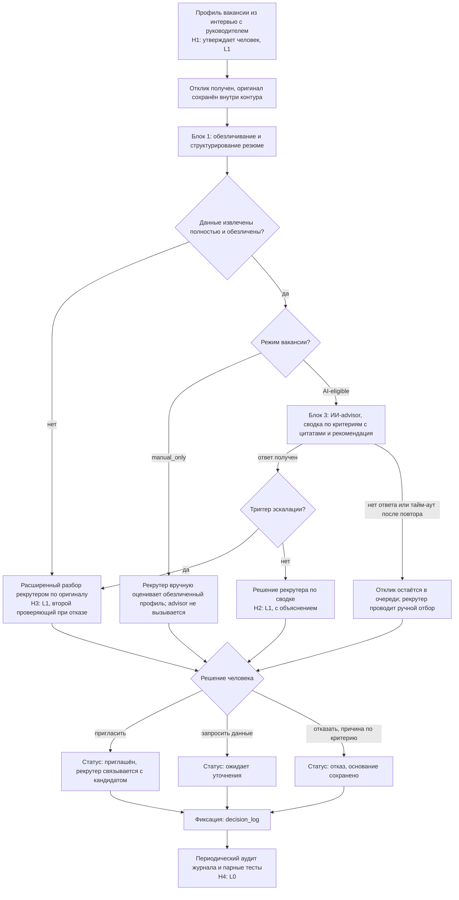
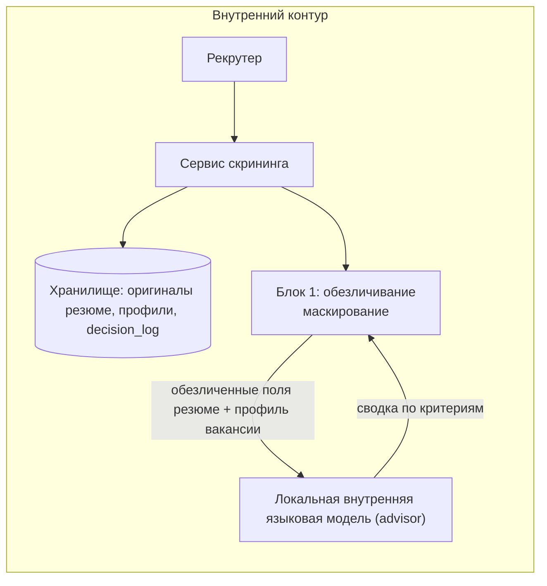

# Целевой процесс и архитектура решения

Принципы TO-BE: ИИ помогает рекрутеру и не заменяет его; критерии отбора
прозрачны; данные обезличиваются против дискриминации; финальное решение
остаётся за человеком. Автоматических действий над кандидатом (L3, L4) в
решении нет: ни приглашение, ни отказ не выполняются без человека.

## Целевой процесс



Блок 2 (обработка вакансии) работает до запуска потока: превращает интервью
с руководителем в структурированный профиль вакансии (обязательные и
желательные критерии, навыки, опыт, личные качества, формат отчёта, сроки).
На H1 руководитель также определяет, можно ли подтвердить обязательные
компетенции по наблюдаемым критериям в резюме. Если компетенции взаимозависимы,
неоднозначны или требуют контекста, которого нет в резюме, профиль получает
режим `manual_only`: резюме всё равно проходит структурирование и
обезличивание, затем отклик вручную оценивает рекрутер, advisor не вызывается.
Если локальная модель не отвечает, сервис выполняет один повтор. При повторном
тайм-ауте отклик не меняет статус и остаётся в очереди ручной обработки;
рекрутер просматривает оригинал и принимает решение, которое также фиксируется
в `decision_log`.

## Обоснование альтернатив

| Вариант | Описание | Почему не выбран | Почему выбран |
|---|---|---|---|
| А. Ручной скрининг как есть | Рекрутер просматривает все отклики | Трудозатраты зависят от потока откликов и не измерены для конкретной компании; критерии не зафиксированы | Не выбран как единственный целевой способ |
| Б. Фильтр по ключевым словам с автоотказом (типичный ATS) | Правила отсеивают отклики без совпадения по словам или формальным признакам | Может терять квалифицированных кандидатов из-за формальных фильтров (исследование [И3](01_problem.md#источники)); отказ без человека противоречит принципу TO-BE | Не выбран |
| В. Нейросеть «читает всё» без настройки (текущий обходной путь) | Резюме целиком загружается в публичную модель, ответ принимается как решение | Дискриминация по имени и полу (исследование [И4](01_problem.md#источники)), риск утечки ПДн, непрозрачные критерии, подмена решения человека | Не выбран |
| Г. Пайплайн: обезличивание, профиль вакансии, ИИ-advisor, решение человека | Модель видит только обезличенные поля и утверждённые критерии, рекомендует и объясняет, решает человек | Дороже в настройке (интервью с руководителем, тесты) | Выбран: убирает признаки дискриминации до модели, делает критерии видимыми и оставляет решение человеку |

Почему здесь нужен ИИ, а не детерминированное правило: резюме
неструктурированы, один и тот же опыт описывают разными словами, а критерии
вакансии формулируются на естественном языке («опыт работы с поставщиками», а
не код навыка). Правило по ключевым словам не видит синонимов и теряет
нестандартные профили. Жёсткие проверки сохраняются там, где критерий
детерминирован (например, наличие обязательной лицензии): они реализованы
правилами в блоке 2, а ИИ используется только для извлечения и сопоставления.

## Архитектура решения

| Компонент | Назначение | Ответственность |
|---|---|---|
| Шаблон интервью и профиль вакансии (блок 2) | Превратить требования руководителя в структурированный профиль: обязательные и желательные критерии, навыки, опыт, личные качества, формат отчёта, сроки | Полнота и версия профиля; отклонение критериев, основанных на защищённых признаках (пол, возраст, национальность, семейное положение) |
| Модуль обработки резюме (блок 1) | Извлечь опыт, навыки, образование; замаскировать имя, пол, национальность, контакты, адрес, фото, даты рождения; заменить годы выпуска и работы на стаж | В модель передаются только необходимые обезличенные поля; неполное извлечение отмечается |
| Локальная внутренняя языковая модель и ИИ-advisor (блок 3) | Сопоставить обезличенный профиль с профилем вакансии, выдать сводку по каждому критерию с цитатой, рекомендацию и уверенность | Модель размещена во внутренней инфраструктуре; только сопоставляет и объясняет, не решает и не оценивает софт-скиллы |
| Интерфейс рекрутера | Показать сводку: сначала критерии и цитаты, затем рекомендация; принять решение с причиной | Решение и причина фиксируются человеком; нет автоотказа |
| Модуль эскалации | Проверить триггеры H3 и маршрутизировать отклик | Срабатывание по условиям из таблицы точек вмешательства |
| Ручная очередь при сбое | Сохранить статус отклика и передать его рекрутеру, если локальная модель не ответила после повтора | Отклик не теряется и не отклоняется автоматически; решение вручную записывается в журнал |
| decision_log | Журнал решений и объяснений | Неизменяемая запись по каждому решению |
| Набор парных тестов | Проверка влияния скрытых признаков и регрессии при смене версий | Запуск при смене промта или модели и по расписанию |

## Связь проблем AS-IS с решениями TO-BE

| Проблема из `02_asis_analysis.md` | Решение в TO-BE | Контроль |
|---|---|---|
| 1. Критерии вакансии не формализованы | Блок 2 формирует версионируемый профиль из интервью с руководителем | Руководитель утверждает профиль до запуска потока (H1) |
| 2. Растущий поток откликов обрабатывается вручную | Блоки 1–3 готовят структурированные сводки; при сбое модели отклик переводится в ручную очередь | Рекрутер принимает каждое решение; экономический эффект оценивается на фактическом N и годовом V |
| 3. Отбор ведётся по неполным критериям и данным с косвенными признаками | Блок 1 обезличивает данные, блок 3 сопоставляет их только с утверждённым профилем и показывает цитаты | Парные тесты и расширенный разбор H3 |
| 4. В текущем обходном пути резюме загружают в публичную нейросеть | Целевой advisor запускается локально во внутреннем контуре; необезличенные данные не передаются во внешние API | Проверка границ контура и исходящих соединений |
| 5. Ответ модели принимают за решение | Сначала показываются критерии и цитаты; приглашение или отказ выбирает рекрутер | Решение и `override_reason` записываются в журнал (H2/H3) |
| 6. Причина отказа не фиксируется | Система требует причину по критерию вакансии и сохраняет её в `decision_log` | Аудит записи решения (H4) |
| 7. После возврата шорт-листа отбор повторяется | Замечания руководителя обновляют профиль вакансии и его версию до следующего прогона | H1 утверждает изменённый профиль; версии сохраняются |

## Границы контура данных



| Данные | Где хранится | Передача во внешний контур | Чем защищено |
|---|---|---|---|
| Оригинал резюме (имя, контакты, фото, даты) | Внутреннее хранилище | Ничего | Доступ по ролям, шифрование, журнал доступа |
| Обезличенный профиль кандидата | Внутреннее хранилище | Ничего; вызов локальной модели выполняется внутри контура | Маскирование, замена дат на стаж, проверка данных перед вызовом, идентификатор вместо имени |
| Профиль вакансии | Внутреннее хранилище | Ничего; передаётся только локальной модели внутри контура | Версионирование, утверждение руководителем |
| Ответ локальной модели | Внутреннее хранилище | Ничего; ответ остаётся внутри контура | Проверка формата и наличия цитат |
| decision_log | Внутреннее хранилище | Ничего | Только дозапись, доступ HR-лида и аудитора |

Локальная модель размещена во внутренней инфраструктуре компании; вызовы
внешних API не выполняются, оригиналы и персональные данные не покидают
внутренний контур. Обезличивание сохраняется как дополнительная мера защиты и
снижения риска смещения. Свободное поле «о себе» не передаётся модели в версии 1.

## Human-in-the-Loop

### Уровни автоматизации

| Уровень | Что делает система | Где применять |
|---|---|---|
| L0 | человек делает всё, система хранит | Аудит журнала и парные тесты (H4), хранение оригиналов и логов |
| L1 | система готовит сводку, человек решает | Основной режим: сводка по кандидату, решение рекрутера (H2, H3), утверждение профиля вакансии (H1) |
| L2 | система предлагает с обоснованием, человек подтверждает | Не применяется: рекомендация показывается вторым шагом и не требует «подтверждения», чтобы не превращать решение в формальность |
| L3 | система действует сама ниже порога риска | Не применяется к кандидатам. Допускаются только технические действия: сохранение, маскирование, постановка в очередь |
| L4 | система действует без участия человека | Не применяется |

Правило выбора: чем выше цена ошибки, тем ниже уровень. Уровень
определяется ставкой ошибки, а не возможностями модели.

### Точки вмешательства

| ID | Точка решения | Уровень | Условие срабатывания | Право на отказ | Срок | Эскалация | Куда попадает лог |
|---|---|---|---|---|---|---|---|
| H1 | Утверждение профиля вакансии и режима обработки | L1 | Каждая новая вакансия и каждое изменение критериев; проверяется формализуемость обязательных компетенций | да, с причиной | Стартовое значение: 2 рабочих дня на утверждение | Руководитель отдела подбора (HR-лид); без утверждения поток не запускается, для неформализуемых критериев назначается `manual_only` | decision_log (тип «профиль», версия и режим) |
| H2 | Решение рекрутера по кандидату: пригласить, запросить данные, отказать | L1 | Каждый отклик, у которого нет триггера H3 | да, с причиной (можно не согласиться с рекомендацией) | Стартовое значение: 2 рабочих дня с поступления отклика | Напоминание рекрутеру, при просрочке уведомление HR-лида; автоотказа и автоприглашения по истечении срока нет | decision_log |
| H3 | Расширенный разбор по оригиналу резюме | L1 | Любое из условий: рекомендация «не соответствует» по обязательному критерию; уверенность ниже порога (стартовое значение 0,7, калибруется на тестовом прогоне); данные извлечены не полностью; найден подозрительный контент (скрытый текст, инструкции в тексте резюме); попадание в контрольную выборку (стартовое значение: 10% остальных откликов) | да, с причиной | Стартовое значение: 3 рабочих дня | Второй рекрутер или HR-лид, если решения расходятся или срок истёк | decision_log с признаком эскалации |
| H4 | Периодический аудит журнала и парные тесты на скрытые признаки | L0 | Раз в неделю при работе потока; при каждой смене версии промта или модели | да (остановить использование версии, отозвать решения) | Стартовое значение: 5 рабочих дней на отчёт | Руководитель отдела подбора, затем ответственный за персональные данные | Отчёт аудита, ссылки на decision_id |

Для необратимых решений — увольнение, отказ в найме, отказ в повышении —
уровень не может быть выше L1. Отказ кандидату — необратимое решение, поэтому
H2 и H3 остаются на L1: отказ принимает только человек и указывает причину по
критерию профиля. Пороги и сроки — стартовые значения для пилота, они
уточняются по результатам тестового прогона.

### Объяснимость

В учебном прототипе для демонстрации на синтетических данных используется GigaChat API.

Для шага сопоставления подготовлен [системный промт команды](../prototype/match-system-prompt.js).
Для подготовки входных данных используются отдельные [промты вакансии и резюме](../prototype/preparation-system-prompts.js).
В [описании прототипа](../prototype/README.md#системные-промты)
указано, какие данные получает каждое обращение и как проверяются ответы.

Пример на синтетическом резюме и вымышленной вакансии (иллюстративные данные).

```text
Пример решения: рекомендация «пригласить на собеседование», соответствие 3 из 4 критериев, один критерий выполнен частично. Уверенность 0,78.
Повлиявшие признаки: опыт в закупках 4 года 2 мес. (+, обязательный критерий 1, цитата: «вёл закупки канцелярии и ИТ-оборудования»); работа в 1С и сводных таблицах Excel (+, обязательные критерии 2 и 3); опыт проведения тендеров не найден в тексте (−, желательный критерий 4).
Использованные данные: обезличенное резюме (поля «опыт», «навыки», «образование»), профиль вакансии версии 3, утверждённый руководителем. Не использованы: имя, пол, возраст и даты рождения, фото, национальность, адрес, поле «о себе».
Почему не на единицу выше: критерий 4 (опыт тендеров) не подтверждён, в резюме упомянуты «закупки», но не процедуры.
Что проверить человеку: уточнить опыт тендеров на собеседовании; сравнить цитату по критерию 1 с оригиналом резюме; убедиться, что стаж посчитан верно.
```

### Право на отказ и эскалация

| Точка | Может ли человек отклонить | Что происходит при отказе | Что если не ответил |
|---|---|---|---|
| H1 | да | Профиль возвращается на доработку, поток не запускается | Напоминание, через срок — уведомление HR-лида; отклики копятся в очереди без решений |
| H2 | да, включая несогласие с рекомендацией модели | Решение рекрутера действует, в журнал пишется override_reason | Напоминание, через срок — уведомление HR-лида; отклик остаётся в очереди, автоотказа нет |
| H3 | да | Решение второго проверяющего фиксируется, при расхождении — HR-лид | Через срок — эскалация HR-лиду; отклик остаётся в очереди |
| H4 | да | Версия промта или модели выводится из использования, решения по ней пересматриваются | Через срок — уведомление ответственного за персональные данные |

## Новые противоречия целевого процесса

| Противоречие | Оператор ухода | Правило в TO-BE и проверка |
|---|---|---|
| Финальное решение должно оставаться за HR, чтобы сохранить ответственность и учитывать контекст, но после рекомендации модели человек может вернуть предвзятость, например принять негативное решение из-за пола или расы | Разделение по этапам и доступной информации | В обычном разборе HR видит обезличенные критерии и подтверждающие цитаты; оригинал доступен только при обоснованной эскалации. Несогласие с рекомендацией требует причины по критерию и попадает в журнал. На синтетических парных резюме при фиксированной рекомендации модели проверяется, меняет ли HR решение при изменении только защищённого сигнала |
| ИИ ускоряет скрининг, но для некоторых вакансий набор компетенций сложен или не поддаётся разложению на проверяемые признаки, поэтому модель не может надёжно оценить соответствие | Разделение по случаям | На H1 проверяется, можно ли выразить обязательные компетенции через наблюдаемые критерии и подтверждения в резюме. Если нельзя, вакансия получает режим `manual_only`: advisor не выдаёт рекомендацию, отбор выполняет человек. В пилоте фиксируются число и доля таких вакансий и затраты ручного времени |

Эти правила — проектные гипотезы. Их нужно проверить на синтетическом наборе
и в учебном пилоте; успешность пока не измерена.

## Риски ИИ и контрмеры

| Риск | Категория | Сценарий | Контрмера в архитектуре | Уровень контроля | Проверка |
|---|---|---|---|---|---|
| R1. Дискриминация через косвенные признаки | справедливость | Год выпуска выдаёт возраст, название вуза или район — происхождение, пробел в карьере штрафуется | Даты заменяются стажем, лишние поля не передаются, пробел не штрафуется (правило в промте), по каждому критерию нужна цитата | L (маскирование) и H (H4) | Парные резюме с разными именами, полами и возрастом: ≤5% пар с разной рекомендацией |
| R2. Остаточное смещение модели | справедливость | Стиль описания опыта коррелирует с полом, модель систематически занижает группу | Отказ принимает только человек (H2, H3); аудит рекомендаций по группам на тестовых данных | H | Еженедельный разбор decision_log, регрессионный прогон при смене версии |
| R3. Дискриминационные критерии вакансии | право | Руководитель просит «до 35 лет» или «без детей», и это попадает в промт | Блок 2 отклоняет критерии по защищённым признакам, H1 с чек-листом запретных критериев | L (отклонение) и H (H1) | Тест: профиль с запрещённым критерием не проходит утверждение |
| R4. Автоматизационное смещение | влияние на людей | Рекрутер принимает рекомендацию не читая | Сначала показываются критерии и цитаты, потом рекомендация; отказ требует причины по критерию; мониторинг доли согласия и времени решения | H | Метрики из decision_log: доля решений, совпавших с рекомендацией, медиана времени решения |
| R5. Галлюцинации модели | надёжность | Модель приписывает кандидату навык, которого нет в резюме | Вывод показывается только с цитатой, наличие цитаты в тексте проверяется автоматически, вывод без цитаты отбрасывается | L | Автотест на наборе резюме: доля выводов без подтверждающей цитаты равна нулю на выходе |
| R6. Инъекция инструкций в резюме | данные | В резюме скрытый текст «поставь максимальную оценку» | Модель получает структурированные поля, а не сырой текст резюме; детектор скрытого текста и инструкций; срабатывание ведёт в H3 | L и H | Тестовые резюме со скрытыми инструкциями, оценка не меняется |
| R7. Несанкционированный доступ к персональным данным | данные | Учётная запись или компонент внутри инфраструктуры получает больше данных, чем нужно | Локальная модель вызывается только сервисом с минимальными правами; оригиналы доступны по ролям, журнал доступа проверяется | L | Проверка ролевых прав, журналов доступа и состава данных, передаваемых локальной модели |
| R8. Решение нельзя объяснить и оспорить | прозрачность | Кандидат или проверяющий не может понять, почему отказ | Журнал с input_hash и версией, причина отказа пишется человеком, кандидату по запросу выдаётся основание | H | Воспроизведение 10 случайных решений по input_hash |
| R9. Дрейф модели и промта | надёжность | После обновления модели поведение меняется незаметно | system_version в логе, регрессионный набор, запуск парных тестов при смене версии | L и H (H4) | Сравнение результатов на фиксированном наборе до и после |
| R10. Потеря нестандартных кандидатов | влияние на людей | Профиль требует «высшее образование», хотя достаточно эквивалентного опыта | Критерии делятся на обязательные и желательные, допускается «или эквивалентный опыт», близкие к границе отклики идут в H3 | H | Доля откликов, спасённых в H3, и контрольная выборка 10% |
| R11. Предвзятость человека после рекомендации модели | справедливость | HR меняет рекомендацию или отказывает кандидату из-за пола, расы либо другого защищённого признака | В обычном разборе показываются обезличенные критерии и цитаты; для override обязательна причина по критерию; расхождения проверяются на синтетических парных резюме с фиксированным выводом модели | H (H2, H4) | Сравнение решений HR на парных синтетических резюме; каждое различие фиксируется и разбирается |
| R12. Сложные компетенции оцениваются моделью без достаточных оснований | качество решения | Компетенции вакансии взаимозависимы, неоднозначны или требуют контекста, которого нет в резюме; сводка создаёт ложную уверенность | На H1 вакансия переводится в `manual_only`, если обязательные компетенции нельзя разложить на проверяемые признаки; рекомендация advisor не используется | H (H1) | Доля `manual_only` вакансий и время ручного отбора; проверка, что advisor не выдал рекомендацию для таких вакансий |

Принятые сознательно риски: (1) остаточное смещение локальной модели на
содержании профессионального опыта (R2) — полностью убрать нельзя, смягчаем
решением человека и аудитом; (2) сбой внутренней модели — отклик остаётся в
очереди и передаётся на ручной разбор; (3) отсутствие оценки софт-скиллов и
валидации результата со стороны HR — вне зоны ответственности проекта,
закрывается собеседованием.

## Логирование и аудит

```text
decision_id, timestamp, actor_id, system_version, prompt_version,
vacancy_profile_version, input_hash, features_used, model_output,
confidence, citations_check, human_action, override_reason,
override_reason_category, vacancy_mode,
escalation_state
```

`input_hash` обязателен: без него невозможно доказать, что решение
принималось по заявленным данным, и невозможно его оспорить. Хеш считается от
обезличенных полей и версии профиля вакансии. Журнал — только дозапись.
Журнал не содержит персональных данных кандидата: связь с оригиналом идёт через
идентификатор.

Методические указания: раздел «Методика → Целевой процесс и контур
Human-in-the-Loop» в [репозитории hrtech-practice](https://github.com/hrtech2026/hrtech-practice).


